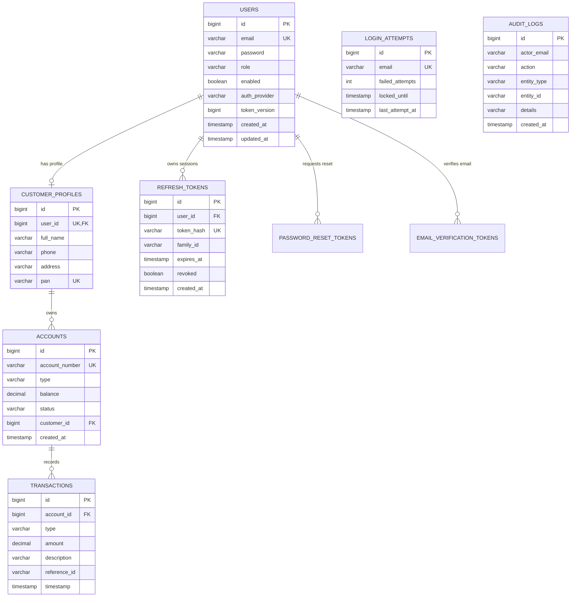

# Northstar Bank — Banking Management System

A full-stack, modular monolithic **Banking Management System** built with **Java 17**, **Spring Boot 3.4.5**, **Spring Security 6**, **Spring Data JPA**, **MySQL 8**, **Flyway**, **JWT (JJWT)**, **Springdoc OpenAPI / Swagger**, and **Thymeleaf + Fetch API**.

---

## 1. Project Overview

Northstar Bank enables secure online banking workflows across two roles:

- **Customer (`ROLE_CUSTOMER`)**:
  - Register (always assigned `ROLE_CUSTOMER`) and log in securely with BCrypt password hashing (`strength = 12`).
  - View and update customer KYC profile details.
  - Open `SAVINGS` and `CURRENT` accounts with unique generated account numbers.
  - Deposit and withdraw funds with `BigDecimal` precision and strict ownership validation.
  - Execute atomic, deadlock-free transfers between active accounts using shared `referenceId` pairs.
  - Browse paginated statements filtered by start date, end date, and transaction type.
  - Change password, reset forgotten passwords with single-use hashed tokens, and log out securely.
- **Administrator (`ROLE_ADMIN`)**:
  - View system summary metrics, all customers, and all accounts.
  - Inspect individual account details.
  - Freeze (`FROZEN`), reactivate (`ACTIVE`), or close (`CLOSED`, zero-balance only) accounts.
  - Filter system-wide transactions by date range and transaction type.

---

## 2. Technology Stack

- **Backend**: Java 17, Spring Boot 3.4.5, Spring Web, Spring Security 6, Spring Data JPA, Hibernate, Bean Validation, Spring Mail
- **Database & Migrations**: MySQL 8, Flyway (`V1`–`V6` SQL migrations)
- **Security**: JJWT `0.12.6`, BCrypt (strength 12), rotating SHA-256 hashed refresh tokens with family reuse detection, `HttpOnly` + `SameSite` cookies, CSRF protection, per-IP rate limiting, pessimistic account lockout
- **Frontend**: Thymeleaf templates & reusable fragments, HTML5, CSS3, Vanilla JavaScript Fetch API (`api.js`)
- **API Documentation & Testing**: Springdoc OpenAPI / Swagger UI (`/swagger-ui/index.html`), Postman collection, JUnit 5, Mockito, Spring Security Test, H2 (test)
- **DevOps**: Docker, Docker Compose, GitHub Actions CI

---

## 3. Architecture & Folder Structure

The project follows a layered modular monolith (`Controller → Service → Repository → MySQL`) using constructor-based dependency injection, DTO boundaries, mappers, and centralized exception handling:

```text
Banking_Management_System/
├── pom.xml
├── Dockerfile
├── docker-compose.yml
├── .env.example
├── .github/workflows/ci.yml
├── postman/
│   ├── Northstar_Bank_API.postman_collection.json
│   └── Northstar_Bank_Local.postman_environment.json
└── src/
    ├── main/
    │   ├── java/com/sprint/bank/
    │   │   ├── BankApplication.java
    │   │   ├── auth/         (controller, service, dto, entity, repository, enums, exception)
    │   │   ├── security/     (jwt, principal, CookieUtil, SecurityUtils, RequestRateLimitFilter)
    │   │   ├── config/       (SecurityConfig, PasswordEncoderConfig, CorsConfig, OpenApiConfig, ApplicationConfig, DataInitializer)
    │   │   ├── controller/   (HomeController, DashboardController)
    │   │   ├── customer/     (controller, service/impl, entity, repository, dto)
    │   │   ├── account/      (controller, service/impl, entity, repository, dto, enums)
    │   │   ├── transaction/  (controller, service/impl, entity, repository, dto, enums)
    │   │   ├── admin/        (controller, service/impl, dto)
    │   │   ├── user/         (entity, repository, dto, enums)
    │   │   ├── mapper/       (UserMapper, CustomerMapper, AccountMapper, TransactionMapper)
    │   │   ├── exception/    (GlobalExceptionHandler, domain exceptions)
    │   │   ├── common/       (ApiResponse, ErrorResponse, PageResponse, AppConstants, AccountNumberGenerator, TokenCryptoUtil)
    │   │   └── audit/        (AuditLog, AuditLogRepository, AuditService)
    │   └── resources/
    │       ├── application.properties
    │       ├── application-dev.properties
    │       ├── application-prod.properties
    │       ├── db/migration/ (V1__create_users.sql ... V6__create_audit_logs.sql)
    │       ├── templates/    (index, error, auth/*, customer/*, admin/*, fragments/*)
    │       └── static/       (css/*, js/*)
    └── test/
        ├── java/com/sprint/bank/...
        └── resources/application.properties
```

---

## 4. Entity-Relationship (ER) Diagram



---

## 5. Database Setup & Environment Configuration

### Environment Variables

Copy `.env.example` and supply your environment variables (never commit real credentials or secrets):

| Variable | Description | Example |
|---|---|---|
| `MYSQL_HOST` | MySQL server hostname | `localhost` |
| `MYSQL_PORT` | MySQL server port | `3306` |
| `MYSQL_DATABASE` | Schema name | `banking_db` |
| `MYSQL_USERNAME` | Database username | `root` |
| `MYSQL_PASSWORD` | Database password | *(your local password)* |
| `JWT_SECRET` | Base64-encoded ≥ 256-bit secret (`openssl rand -base64 32`) | *(generated secret)* |
| `JWT_ACCESS_EXPIRATION` | Access token TTL in ms | `900000` (15 min) |
| `JWT_REFRESH_EXPIRATION` | Refresh token TTL in ms | `604800000` (7 days) |
| `MAIL_HOST`, `MAIL_PORT`, `MAIL_USERNAME`, `MAIL_PASSWORD` | SMTP credentials (optional in dev) | `smtp.example.com` |
| `FRONTEND_ORIGIN` | Allowed CORS origin(s) | `http://localhost:8080` |
| `SPRING_PROFILES_ACTIVE` | Active Spring profile (`dev` or `prod`) | `dev` |

Flyway automatically creates and validates tables via `src/main/resources/db/migration/V1__create_users.sql` through `V6__create_audit_logs.sql`.

---

## 6. Running the Application

### Option A: PowerShell + Maven Wrapper (Local MySQL 8)

```powershell
$env:SPRING_PROFILES_ACTIVE = "dev"
$env:MYSQL_HOST = "localhost"
$env:MYSQL_PORT = "3306"
$env:MYSQL_DATABASE = "banking_db"
$env:MYSQL_USERNAME = "root"
$env:MYSQL_PASSWORD = "your_mysql_password"
$env:JWT_SECRET = "<base64-encoded-32-byte-secret>"
$env:SEED_DEMO_DATA = "true"
$env:SEED_ADMIN_PASSWORD = "Admin@Bank2026!"
$env:SEED_CUSTOMER_PASSWORD = "Customer@Bank2026!"

.\mvnw.cmd spring-boot:run
```

Open:
- Web Application: `http://localhost:8080`
- Swagger UI: `http://localhost:8080/swagger-ui/index.html`
- OpenAPI JSON: `http://localhost:8080/v3/api-docs`

### Option B: Docker Compose

```powershell
docker compose up --build
```

---

## 7. Authentication & Authorization Flow

1. **Login / Registration**: `POST /api/auth/login` or `POST /api/auth/register` validates credentials via `AuthenticationManager` and `BCryptPasswordEncoder(12)`, issues a short-lived signed JWT access token (`userId`, `role`, `tokenVersion`, `iss`, `sub`, `exp`) and a cryptographic random refresh token (only its SHA-256 hash is persisted).
2. **Browser Security**: Tokens are set in `HttpOnly`, `SameSite`, `Secure`-configurable cookies (`refresh_token` scoped to `/api/auth` and `access_token` for protected Thymeleaf view access). `api.js` keeps active tokens in memory only (never `localStorage`) and sends `X-XSRF-TOKEN` for CSRF protection.
3. **Refresh Token Rotation & Replay Detection**: `POST /api/auth/refresh` locks the token row (`PESSIMISTIC_WRITE`), revokes the old token, and issues a rotated pair in the same `familyId`. Reusing a revoked token immediately revokes the entire token family even when returning `401 Unauthorized`.
4. **Immediate Revocation**: `POST /api/auth/logout`, password changes, and password resets increment `User.tokenVersion` and revoke all active refresh tokens, immediately invalidating outstanding access tokens.
5. **Lockout Protection**: Repeated invalid login attempts lock the account under a pessimistic row lock (`423 Locked`).
6. **Role-Based Access**:
   - `ROLE_CUSTOMER`: `/customer/**`, `/api/customers/**`, `/api/accounts/**`, `/api/transfers` (strict ownership checks on every account ID).
   - `ROLE_ADMIN`: `/admin/**`, `/api/admin/**` (system oversight, customer directory, account freeze/activate/close, global transaction filters).

---

## 8. REST API Reference

| Method | Endpoint | Access | Description |
|---|---|---|---|
| `POST` | `/api/auth/register` | Public | Register a new `CUSTOMER` and `CustomerProfile` |
| `POST` | `/api/auth/login` | Public | Authenticate user and issue tokens/cookies |
| `POST` | `/api/auth/refresh` | Public (token/cookie) | Rotate refresh token and issue new access token |
| `POST` | `/api/auth/logout` | Authenticated | Revoke sessions and clear cookies (`204`) |
| `GET` | `/api/auth/me` | Authenticated | Retrieve current user details |
| `POST` | `/api/auth/forgot-password` | Public | Request single-use password reset link (`202`) |
| `POST` | `/api/auth/reset-password` | Public | Reset password with single-use token (`204`) |
| `POST` | `/api/auth/change-password` | Authenticated | Change password with current password (`204`) |
| `GET` | `/api/auth/verify-email` | Public | Verify email via `?token=...` |
| `GET/PUT` | `/api/customers/me` | `CUSTOMER` | View or update authenticated customer profile |
| `POST` | `/api/accounts` | `CUSTOMER` | Open `SAVINGS` or `CURRENT` account (`201`) |
| `GET` | `/api/accounts` | `CUSTOMER` | List authenticated customer's accounts |
| `GET` | `/api/accounts/{id}` | `CUSTOMER` (Owner) | Get owned account details |
| `POST` | `/api/accounts/{id}/deposit` | `CUSTOMER` (Owner) | Deposit into owned `ACTIVE` account |
| `POST` | `/api/accounts/{id}/withdraw` | `CUSTOMER` (Owner) | Withdraw from owned `ACTIVE` account |
| `GET` | `/api/accounts/{id}/transactions` | `CUSTOMER` (Owner) | Paginated statement (`startDate`, `endDate`, `type`, `page`, `size`) |
| `POST` | `/api/transfers` | `CUSTOMER` (Owner) | Atomic transfer with deterministic row locks |
| `GET` | `/api/admin/customers` | `ADMIN` | List all registered customers |
| `GET` | `/api/admin/accounts` | `ADMIN` | List all bank accounts |
| `GET` | `/api/admin/accounts/{id}` | `ADMIN` | Get account details |
| `PUT` | `/api/admin/accounts/{id}/status` | `ADMIN` | Update account status (`ACTIVE`, `FROZEN`, `CLOSED`) |
| `GET` | `/api/admin/transactions` | `ADMIN` | Filter system transactions by date and type |

---

## 9. Postman Setup

1. Import [Northstar_Bank_API.postman_collection.json](postman/Northstar_Bank_API.postman_collection.json) and [Northstar_Bank_Local.postman_environment.json](postman/Northstar_Bank_Local.postman_environment.json).
2. Select the **Northstar Bank Local** environment (`baseUrl = http://localhost:8080`).
3. Run **Login** (or **Register Customer**) — collection test scripts automatically store `accessToken` and `refreshToken` for subsequent Bearer-authenticated requests.

---

## 10. Demo Credentials (Development Profile Only)

> **Never enable `app.seed.enabled=true` or use demo credentials in production.**

When running with `SPRING_PROFILES_ACTIVE=dev`, `SEED_DEMO_DATA=true`, and the dev seed password environment variables (`SEED_ADMIN_PASSWORD=Admin@Bank2026!`, `SEED_CUSTOMER_PASSWORD=Customer@Bank2026!`):

- **Admin**: `admin@northstarbank.com` / `Admin@Bank2026!`
- **Customer 1**: `aarav.sharma@northstarbank.com` / `Customer@Bank2026!` (1 Savings + 1 Current account + transactions)
- **Customer 2**: `priya.patel@northstarbank.com` / `Customer@Bank2026!` (1 Savings account + transfer history)

---

## 11. Running Tests

```powershell
.\mvnw.cmd test
```

If running in restricted environments where Maven file locks or dynamic ByteBuddy attach are disallowed:

```powershell
.\mvnw.cmd test "-Daether.syncContext.named.factory=noop" "-DargLine=-javaagent:$env:USERPROFILE\.m2\repository\net\bytebuddy\byte-buddy-agent\1.15.11\byte-buddy-agent-1.15.11.jar"
```

---

## 12. Recommended Git Commits

- `chore: align Maven build to Spring Boot 3.4.5 with Flyway and Springdoc`
- `feat(db): add Flyway V1-V6 migrations and domain JPA entities`
- `feat(auth): implement JWT auth, refresh rotation, HttpOnly cookies, and lockout`
- `feat(banking): add customer profile, accounts, deposits, withdrawals, and atomic transfers`
- `feat(admin): implement admin oversight, account status controls, audit logs, and exception handling`
- `feat(ui): build Thymeleaf portals and Fetch API client without localStorage tokens`
- `docs: add OpenAPI configuration, Postman collection, Docker setup, CI workflow, and README`
- `test: add unit, security, concurrency transfer, and end-to-end integration tests`
